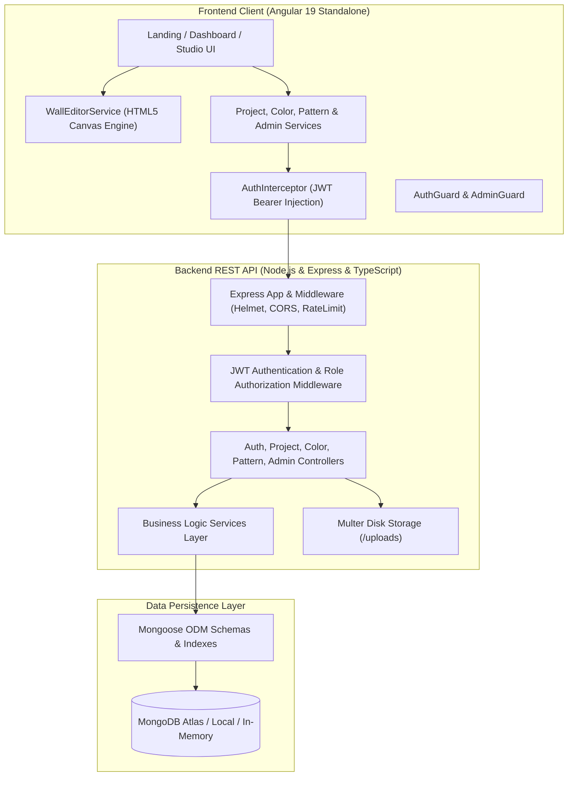
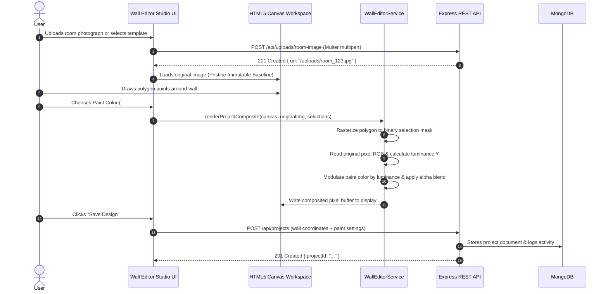

# Smart Wall Paint Visualizer - System Architecture

## 1. High-Level Architecture Overview

Smart Wall Paint Visualizer is engineered on the **MEAN Stack** (MongoDB, Express.js, Angular 19, Node.js), adhering to clean separation of concerns, modular software design, and strict security isolation.

---

## 2. Wall Visualization & Canvas Pipeline

---

## 3. Security & Access Control Model

1. **Authentication:**
   - Stateless JSON Web Tokens (JWT) signed with HS256 algorithm and environment secret.
   - Passwords hashed using `bcryptjs` with salt work factor 10.
   - Plaintext passwords and hash are excluded from serialization and JSON API outputs.

2. **Role-Based Authorization:**
   - Two strict roles: `user` and `admin`.
   - Public registration strictly assigns role `user`.
   - Admin accounts are provisioned via documented seed or environment configuration.
   - Administrative endpoints (`/api/admin/*`, `POST/PATCH/DELETE /api/colors`, etc.) reject regular users with HTTP 403 Forbidden.

3. **Ownership Verification:**
   - Endpoints `/api/projects/:id` strictly evaluate `project.userId === req.user.userId`.
   - Prevents unauthorized ID spoofing or horizontal privilege escalation.

4. **Media Validation:**
   - Uploaded files are checked for both permitted file extensions (`.jpg`, `.jpeg`, `.png`, `.webp`) and MIME types (`image/jpeg`, `image/png`, `image/webp`).
   - File size enforced by multer (default 10MB limit).
