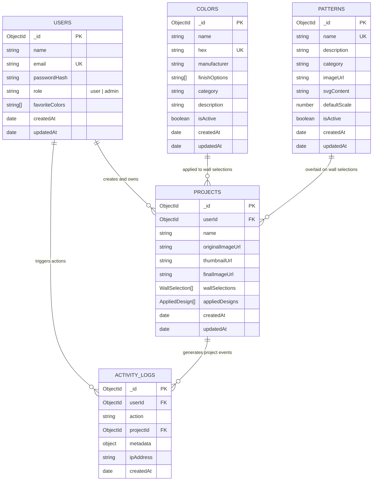

# MongoDB Schema Design & Relationships

Mongoose schemas are configured with strict type definitions, timestamps, validation constraints, and indexes.

---

## Indexing Strategy

1. **`User` Collection:**
   - `{ email: 1 }` (Unique, case-insensitive, primary user identifier)
   - `{ role: 1 }` (Quick filtering for administrator queries)

2. **`Project` Collection:**
   - `{ userId: 1, createdAt: -1 }` (Compound index for fetching user projects in reverse chronological order)
   - `{ userId: 1, name: 1 }` (Compound index for user project search)

3. **`Color` Collection:**
   - `{ hex: 1 }` (Indexed for color deduplication)
   - `{ category: 1, isActive: 1 }` (Catalog browsing)
   - Full-text index on `{ name: "text", category: "text", manufacturer: "text" }`

4. **`ActivityLog` Collection:**
   - `{ createdAt: -1 }` (Time-series audit trail)
   - `{ userId: 1, createdAt: -1 }` (User activity tracking)
